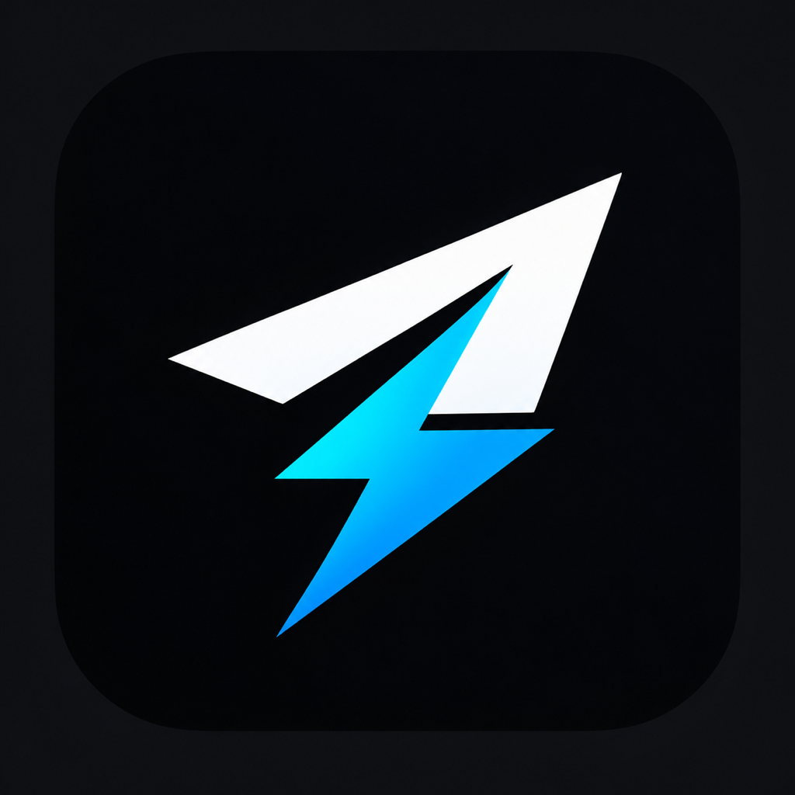

<div align="center">
  
  
  <h2 align="center">ChargedGram for macOS</h2>
</div>


ChargedGram is a fork of [Telegram for macOS](https://macos.telegram.org/) with optional features available in Settings → ChargedGram. See [the features below](#chargedgram-features) and [local build instructions](INSTALL.md#signing).

## ChargedGram features

- **Keep Chats Unread** — stops chats and topics from being marked as read automatically.
- **Confirm Calls** — asks for confirmation before starting an outgoing voice or video call to prevent accidental calls.
- **Hide Phone Numbers** — covers phone numbers in profiles and your account header with spoilers. Click a hidden number to reveal it.
- **Show Deleted Messages**
- **Show reaction by hover**

## Upstream client

The following links install the official Telegram client. Build ChargedGram from this repository using the instructions below.

[](https://itunes.apple.com/us/app/telegram/id747648890?mt=12)

### Using `mas-cli`

```
mas install 747648890
```

### Manual download

If you would like, you can [download the non-MAS version](https://telegram.org/dl/macos).

You can also [download the beta version](https://telegram.org/dl/macos/beta) if you want to try the latest features and you are prepared for bugs and crashes. If you are running the beta, join the [beta testing chat on Telegram](https://t.me/macswift) to report bugs.

## Contributors

### Contributors on GitHub
See [this repository’s contributors graph](https://github.com/macosswift/telegram/graphs/contributors).

### Bugs and Suggestions
You can report bug or suggestions feature for Telegram for macOS on [Telegram’s Bugs & Suggestions platform](https://bugs.telegram.org). Read [the platform tip](https://bugs.telegram.org/c/746) before creating first card.

### Translations
You can help translate Telegram for macOS on [Telegram’s translations platform](https://translations.telegram.org). Pick your language, then look for the macOS translation set.

<!--### Third-party libraries-->
<!--See [LIBRARIES](LIBRARIES.md).-->

## Permissions
Telegram strives to protect your privacy.  This app asks for as few permissions as possible:

* **Microphone**: You can send voice messages and make audio calls with Telegram.
* **Camera**: You can set your profile picture using your Mac’s iSight camera.
* **Location**: You can send your location to friends.
* **Outgoing network connections**: Telegram needs to connect to the internet to send your messages to your friends.
* **Incoming network connections**: Telegram needs to accept incoming connections for peer-to-peer voice calls.
* **User-selected files**: You can save files or images to your Mac.
* **Downloads folder**: Telegram can automatically download files or images you receive.

## Shortcuts
With [Shortcuts](https://github.com/macosswift/telegram/wiki) you can learn how easy is navigate using your devices.

## License
Telegram for macOS is licensed under the GNU Public License, version 2.0. See [LICENSE](LICENSE) for more information.

## Forking
You can fork this application and make something awesome! Make sure that your fork follows these five requirements:

1. **Do** [get your own API ID](https://core.telegram.org/api/obtaining_api_id).
2. **Don’t** call your fork **Telegram** — or at least make sure your users understand that yours is unofficial.
3. **Don’t** use our standard logo (white paper plane in a blue circle) for your fork.
3. **Do** read and follow our [security guidelines](https://core.telegram.org/mtproto/security_guidelines) to make sure you take good care of your users’ data and protect their privacy.
4. **Do** publish your code. The [GPL license](LICENSE) requires it!

## How to Build

Quick start (full details, requirements and troubleshooting are in [INSTALL.md](INSTALL.md)):

1. Install Xcode 16 or newer, Homebrew and a Rust toolchain (rustup). On Xcode 27, apply the local changes in
   [XCODE27.md](XCODE27.md) first: it supports macOS 12.0 and newer only, and the project targets 10.13.
2. Clone with submodules:
   ```
   git clone --recurse-submodules https://github.com/macosswift/telegram.git
   ```
3. Prepare the machine and build the native libraries once:
   ```
   sh scripts/setup_build_env.sh --build
   ```
4. Open `Telegram-Mac.xcworkspace` in Xcode and build the `Telegram` scheme.
