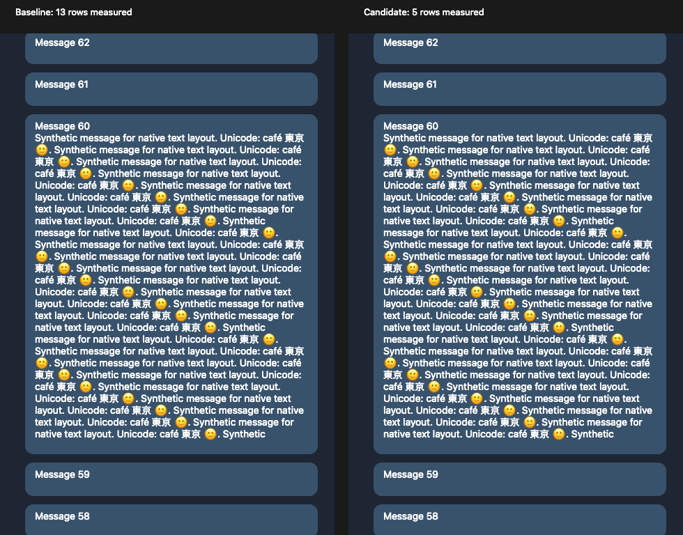

# ChatController opening and scrolling lab

This standalone AppKit mini-app tests the chat controller's first history transition, remaining-row transition, scroll-button updates, and floating-avatar reveal lookup. It needs no Telegram account, main-app build, or telegram-ios dependency.

## Run

From the repository root on macOS with Xcode command-line tools:

```sh
tools/perflab/ChatControllerLab/run.sh test
tools/perflab/ChatControllerLab/run.sh release-test
tools/perflab/ChatControllerLab/run.sh tsan
tools/perflab/ChatControllerLab/run.sh asan
tools/perflab/ChatControllerLab/run.sh bench
tools/perflab/ChatControllerLab/run.sh bench --preview
tools/perflab/ChatControllerLab/run.sh bench --snapshot /tmp/chat-viewport.png
```

Build products and generated sources go in the temporary directory. `CHAT_CONTROLLER_LAB_WORK` overrides that location. `--preview` opens two real AppKit tables showing baseline and candidate initial windows. Close the process to end the preview. `--snapshot` saves the same comparison without displaying a window.

`prepare.py` extracts the current selection and completion blocks, the entire `updateScroller` method, and the reveal-search expression from `ChatController.swift`. It copies `ChatInitialRowSelection.swift` without modification. It also extracts the actual `TableScrollFocus` into a separate Swift module, checking the new read-only `isWholeRow` property across a module boundary. Frozen pre-change blocks live in `Fixtures`. The generated package has no dependencies outside the lab and system frameworks.

The surrounding message, signal, and animation types are controlled adapters. The real signal scheduler, multimedia row constructors, Telegram model, and Core Animation completion timing are not reproduced. The native text benchmark uses NSString/AppKit text measurement for synthetic messages. The table tests use actual NSTableView, NSScrollView, NSWindow, row geometry, and bitmap rendering.

## Changes

- **Centered opening:** count the anchor's height toward the initial viewport, so neighboring offscreen rows can be measured in the existing background phase. For a 500-point message in a 720-point viewport, initial measurement falls from 13 rows to 5. Build the selected contiguous range directly instead of sorting and rebuilding its insertion array. A one-point margin covers existing scroll rounding. At history edges, fill the other side to avoid a short initial document and temporary blank space.
- **Conservative fallback:** text search targets, inner album targets, nonzero relative offsets, oversized anchors, and ignored anchors keep the original neighbor budget. Top/restored-position and ordinary latest-message opening retain their selection code.
- **Scrolling:** the per-pixel listener only lays out navigation controls when their desired visibility changes. Full history and geometry updates still lay out the controls. Repeated updates no longer invoke the equal-opacity completion while a fade is running, and a stale fade completion cannot hide a newly shown control.
- **Empty history:** finish the background transition after the loop, including when there are zero entries. Previously, completion was reachable only from the final loop iteration.
- **Floating avatars:** use a lazy reveal-view search, avoiding an intermediate array and stopping view lookup at the first matching row.

The new generic `TableScrollFocus.isWholeRow` accessor exposes whether a target includes text or an inner message; it does not change scroll behavior or equality. Feature selection logic stays in ChatUI.

## Evidence

`Evidence/validation.json` records configurations and limitations; `Evidence/provenance.json` records source hashes. Raw tests, benchmark JSON, and the rendered comparison are in the same directory.

The tests cover 4,000 deterministic randomized histories, contiguous insertion indices, exactly-once measurement, recombination with the background rows, viewport coverage, fractional row heights within the table's existing one-point rounding tolerance, short histories, zero-size rows, missing anchors, cancellation, empty completion, search and album fallback, scroller thresholds, resize, interrupted fades, and reveal lookup. A native table test compares viewport geometry against the complete history. A second compares every rendered pixel between baseline and candidate for the large-message fixture.

Benchmark medians use 11 paired batches, alternating which implementation runs first, after warmup. Timing varies with other desktop work. Row and callback counts are deterministic:

| Scenario | Baseline initial rows | Candidate initial rows |
| --- | ---: | ---: |
| Short centered message | 13 | 13 |
| 300-point centered message | 13 | 9 |
| 500-point centered message | 13 | 5 |
| Oversized centered message, fallback | 13 | 13 |
| Anchor at history edge | 7 | 13 |

The large-message native-layout fixture measured approximately 1.7× faster. The edge fixture intentionally does more initial work to fill the viewport: this is a correctness tradeoff, not a speedup. Total history rows are still all constructed; the optimization moves work off the initial main-thread phase. For 1,000 same-visibility scroll ticks, frame-update calls fall from 4,000 to 4. This is a small control-layout component, not a claim of a comparable FPS improvement.



## Remaining validation and audit findings

No full Telegram build or signed-in UI smoke test was run. These results do not establish total chat-opening latency, scrolling FPS, GPU usage, or that every workflow is unaffected. The extracted blocks are compiled and executed, but the full ChatUI dependency graph is not typechecked. The pure selection helper also typechecks with Swift 5 for x86_64 macOS 10.13; the edited app files pass syntax parsing.

The audit also examined `prepareEntries`, the combined history pipeline, readiness gates, floating avatars, scroll listeners, `applyTransition`, table geometry, sticky-row lookup, and navigation badges. Several suspected hotspots already have guards: sticky-row binary search, unchanged badge counts/theme, interactive-reading identity, visible-avatar range caching, and premeasured row widths. They were left intact. General opening still performs `messageEntries` and history differencing; scrolling still updates visible bubble gradients and schedules visible-message processing. Those need account-backed profiles before larger changes. The existing `ChatNavigationLab` can measure end-to-end behavior once a current main-app build is available.

Recommended main-app smoke coverage is centered message links, text search and album results, loading an empty chat, opening near both history boundaries, reply-stack navigation, rapid scrolling across the 80-point scroller threshold, resize and unread badge changes, and swipe-to-reveal with floating avatars.
